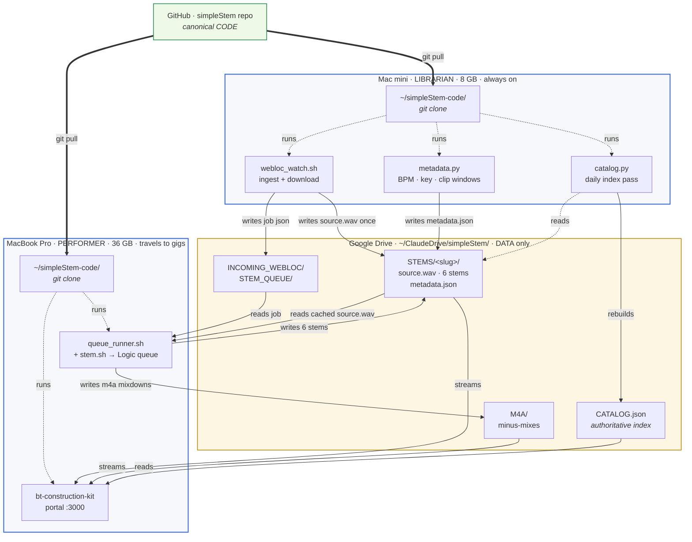
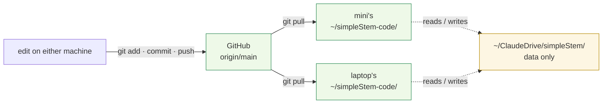
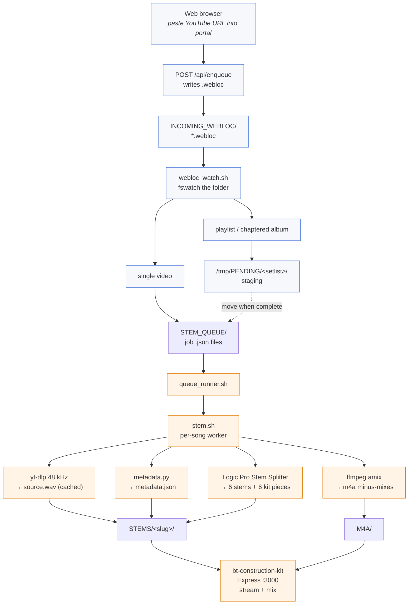
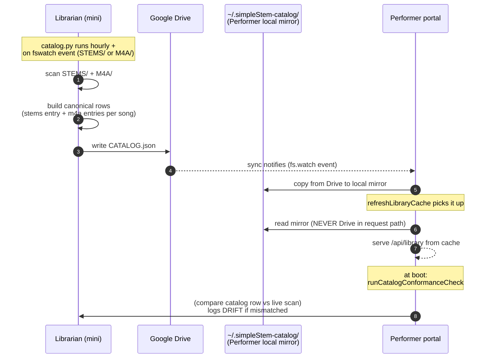

# Mark5 — architecture

This document is for forkers, developers, and the project owner refreshing
the design. It covers the two-machine model, the code/data separation, the
end-to-end pipeline, the data contracts, the code map, the optional Logic
Pro escape hatch, and operations.

If you're a bandmate using the portal, [USER_GUIDE.md](USER_GUIDE.md) is
the document you want instead.

---

## The page-1 picture



Two things to internalize from this diagram:

1. **Code lives in GitHub; data lives in Drive.** Neither machine clones
   the repo *into* Drive — both clone to `~/simpleStem-code/` on local
   disk. This is intentional: a previous setup had `.git` inside Drive
   and Drive's sync would race the git index and corrupt the repo.
2. **The two machines have non-interchangeable roles.** The Librarian
   never stems; the Performer never runs the ingest watcher. They
   share only the Drive data folder.

The rest of this doc unpacks each part.

---

## Why two machines

| Machine | Role | RAM | Uptime | Drive mode | Runs | Never runs |
|---|---|---|---|---|---|---|
| **Mac mini** | **Librarian** | 8 GB | 24/7 | mirrors Drive to external SSD | `librarian.sh` → `webloc_watch.sh` + daily `catalog.py` | stemming |
| **MacBook Pro** | **Performer** | 36 GB | travels to gigs | streams Drive, pins active jobs | `performer.sh` → `queue_runner.sh` (ingest → Logic stemming queue) + portal | heavy ingest |

The split was reversed in May 2026 (commit `327ff83`). The original
arrangement had the mini doing the stem separation while the laptop served
the portal; separation ran the mini out of memory ("out of application
memory" crash). Moving it to the 36 GB laptop fixed that, and let the mini
specialize in the lightweight 24/7 ingest work it was always better at.

**One implication:** the audio that backs every song crosses the network
exactly once, from YouTube to the Librarian's disk, then becomes
`STEMS/<slug>/source.wav` (the cache). The Performer reuses that cached
file rather than re-downloading from YouTube. The big audio never
touches the gig tether.

---

## Code/data separation and git workflow



**Rules:**

- Always work in `~/simpleStem-code/` (the git clone). Never edit code
  inside `~/ClaudeDrive/simpleStem/` — that folder is data-only now.
- Pull before editing, commit small, push immediately. The other machine
  pulls before its next edit.
- If `git push` complains about a stale `.git/index.lock` or
  `.git/HEAD.lock`, that's Drive sync residue from the older setup —
  `rm -f .git/index.lock .git/HEAD.lock .git/objects/maintenance.lock`
  and retry.

**What gets git-tracked:**

- All scripts (`*.sh`, `*.py`)
- `bt-construction-kit/` (Express server + static UI)
- Docs (`*.md`)
- Configuration files for installers / pipeline (`mpb_sync_config.json`, etc.)

**What's git-ignored:**

- `STEMS/`, `STEM_QUEUE/`, `LOGIC_QUEUE/`, `INCOMING_WEBLOC/` — runtime data
- `.run/` — pidfiles and logs
- `node_modules/` — npm
- `*.log`, `CATALOG.json` — derived state

---

## End-to-end pipeline

The full lifecycle of a song, from a pasted YouTube URL to playback in
the portal.



(Blue nodes run on the Librarian, orange on the Performer. Brown data
nodes live in Drive and are visible to both.)

### Stages

1. **Ingest** — the portal's "Add from YouTube" box (or any file dropped
   into `INCOMING_WEBLOC/`) becomes a `.webloc` plist. `webloc_watch.sh`
   classifies it: single video → one queue file; playlist or chaptered
   album → a staged setlist that gets moved into `STEM_QUEUE/` once
   every chapter is staged.
2. **Acquire source** — for single videos, the audio is downloaded at
   48 kHz and written to `STEMS/<slug>/source.wav` (the *cache*; never
   deleted). For album chapters, the whole album video is downloaded
   once and sliced per chapter.
3. **Metadata** — `metadata.py` writes `metadata.json` next to
   `source.wav`, so BPM/key/release-date are captured at ingest.
   Idempotent.
4. **Ingest, then Logic stemming** — `queue_runner.sh` (on the Performer) picks up the job,
   sees `source.wav` already cached, writes `<slug>_SOURCE.m4a` and an
   entry in `LOGIC_QUEUE/`. The Logic Pro Stem Splitter run over that
   queue (started from the Performer's "Logic stemming queue" panel)
   produces the six stems and six kit pieces as m4a.
5. **No mixdowns.** The minus-mixes (`_-V`, `_-V-G`, `_-V-G-B`, `_DO` in `M4A/`) were retired in
   June 2026; the mixer's INSTRUMENT ROUTING buttons (SOURCE, STEMS, D, BD, B, BDV) do that job live.
6. **No automatic loops.** The loop detector (`loop_detect.py`) was retired in
   June 2026 along with the mixdowns.
7. **Serve** — `bt-construction-kit` reads `STEMS/`, `M4A/`, and each
   song's `metadata.json`; streams audio through `/api/audio/...`
   endpoints with a local cache at `~/.bt-cache`.

---

## The cache: `source.wav` is fetched once

A small but important design property: YouTube is contacted exactly
once per song. The Librarian downloads `source.wav` into
`STEMS/<slug>/source.wav` (where `stem.sh` already looks for an
existing source); the Performer reuses it without re-fetching.

For chaptered "full album" videos, the album is downloaded once and
each chapter is sliced to its own per-song `source.wav` cache. (Earlier
versions re-downloaded the whole album once per chapter — N times the
bandwidth.)

Since 2026-11-01 nothing is kept as WAV (CONTRACTS F-1). When `stem.sh`
finishes, the stereo original is in `STEMS/<slug>/<slug>_SOURCE.m4a`
(F-9) and `source.wav` is deleted. A re-ingest rebuilds the working
`source.wav` from that m4a instead of downloading again; the Logic stemming
run and the catalog's BPM/key fill read the m4a. Older songs were
converted by `backfill_source_m4a.sh` (YouTube fetches paced 1–3 min apart).

The benefit: at a gig, the laptop tether never hits YouTube. All audio
is already in Drive, and the portal serves from the on-disk
`~/.bt-cache` mirror.

---

## CATALOG.json — the shared index

`CATALOG.json` is the authoritative library index: title, artist, BPM,
key, available renditions (stems + each m4a variant), status per song.
It is **derived data** (rebuilt from `STEMS/` and `M4A/` by the
Librarian), which means it belongs in Drive next to the data it indexes
— not in the git repo. Authoritative path:

```
~/ClaudeDrive/simpleStem/CATALOG.json
```

### Producer / consumer split

`CATALOG.json` is the single contract between two row shapers — the
**Producer** (`catalog.py` on the Librarian) and the **Consumer** (the
portal's `tryLoadFromCatalog` on the Performer). Both sides must agree
on the row format, byte-for-byte.



### Layered freeze prevention

Three layers cooperate to keep Drive's sync icon spinning without
freezing the portal:

1. **Async scan fallback (`scanStems` / `scanM4a`)** — when the
   catalog isn't usable, the portal still falls back to walking the
   directories, but via `fs.promises.readdir` with `Dirent` types so
   the event loop yields between filesystem calls. A 30-second Drive
   stall during scan no longer locks up audio streaming.

2. **CATALOG.json as primary source** — when present and well-shaped,
   the portal reads the catalog instead of walking directories. ~200KB
   file, one read, fully avoids the per-folder filesystem traversal.

3. **Local mirror at `~/.simpleStem-catalog/CATALOG.json`** — copied
   from Drive on startup, on `fs.watch` events on the Drive folder,
   and on a 60-second poll. Library serving reads ONLY this local
   mirror — Drive is never in the request path. A mirror update fires
   a `refreshLibraryCache` so the in-memory cache catches up.

### Canonical row shape

```json
{
  "generated_at": "...ISO UTC...",
  "source_mtimes": { "stems": "...", "m4a": "..." },
  "data": {
    "stats": { "totalSongs": 224, "totalFiles": 1100, "totalStems": 224,
               "totalM4as": 876, "artistCount": 95,
               "bpmDistribution": { "slow": 18, "medium": 91, "fast": 110, "unknown": 5 },
               "keyDistribution": { "D major": 32, "A minor": 12, "..." : 0 } },
    "songs": [
      {
        "id": "stem-Harvest_Moon_Neil_Young",
        "type": "stems",
        "variantCode": "STEMS",
        "variantLabel": "Multitrack Stems",
        "folderName": "Harvest_Moon_Neil_Young",
        "title": "Harvest Moon",
        "artist": "Neil Young",
        "practiceBpm": 112.7,
        "key": "D major",
        "keySignature": "2 sharps",
        "stems": { "vocals": "vocals.m4a", "drums": "drums.m4a",
                   "bass": "bass.m4a", "guitar": "guitar.m4a",
                   "piano": "piano.m4a", "other": "other.m4a",
                   "rhythm": "bass+drums.wav", "source": "source.wav" },
        "loops": [],
        "duration": 300,
        "cached": false,
        "logicProjectName": null,
        "stats": { "stemCount": 6, "loopCount": 0 }
      },
      {
        "id": "m4a-Harvest_Moon_Neil_Young_-V-G.m4a",
        "type": "m4a",
        "fileName": "Harvest_Moon_Neil_Young_-V-G.m4a",
        "title": "Harvest Moon",
        "artist": "Neil Young",
        "practiceBpm": 112.7,
        "key": "D major",
        "duration": 300,
        "cached": false,
        "variantCode": "-V-G",
        "variantLabel": "No Vocals/Guitar"
      }
    ]
  }
}
```

`songs` is a **flat list**: one `stems` row per `STEMS/<base>/`, plus
one `m4a` row per non-loop file in `M4A/`. Both row shapers — JS
`scanStems`/`scanM4a` and Python `catalog.py` — produce identically
shaped rows for the same source data.

### Conformance check (drift guard)

On portal startup, `runCatalogConformanceCheck` takes the first stems
row from the catalog, runs a live `scanStems` for that same folder,
and compares the canonical fields (`title`, `artist`, `practiceBpm`,
`key`, `keySignature`, `duration`, `logicProjectName`). Differences
log:

```
[catalog-conformance] DRIFT detected on <base>:
  title: catalog="Old Title" vs live="New Title"
  → either update catalog.py or scanStems to match
```

The portal keeps working — the catalog data is served either way —
but DRIFT is the signal to update one side. The two row shapers must
agree, and this check is the early warning.

### Schedule (Librarian)

`librarian.sh` runs three long-running services:

| Service | What | Triggered by |
|---|---|---|
| `watcher` | `webloc_watch.sh` — ingest dropped YouTube URLs | `fswatch` on `INCOMING_WEBLOC/` |
| `cataloger` | `catalog.py` loop | hourly (`CATALOG_INTERVAL=3600`) |
| `catalogwatch` | `catalog.py` reactive trigger | `fswatch -r --latency 5` on `STEMS/` and `M4A/` |

The reactive `catalogwatch` rebuilds within ~5 seconds of any file
add or delete in the stems or m4a directories, so the Performer sees
newly-stemmed songs without waiting for the hourly cron. The 5-second
coalesce window means a single ingest (which writes a bunch of files
in rapid succession) fires one rebuild, not twenty.

`./librarian.sh catalog` runs `catalog.py` once on demand — useful
for verifying a change to the producer before letting the
schedule pick it up.

---

## Data contracts

These are the producer/consumer agreements between scripts. **Change
both sides together** — the portal and the pipeline tools need to
agree on shape.

### `metadata.json` (per song)

Producer: `metadata.py`. Consumer: `bt-construction-kit/server.js`.

```json
{
  "title": "Harvest Moon",
  "artist": "Neil Young",
  "youtube_title": "Neil Young - Harvest Moon (Official Music Video)",
  "youtube_uploader": "NeilYoungChannel",
  "release_date": "1992-10-27",
  "source_url": "https://www.youtube.com/watch?v=...",
  "version": "studio",
  "duration_sec": 300,
  "clip_start_sec": null,
  "clip_end_sec":   null,
  "bpm": 112.7,
  "key": "D major",
  "key_signature": "2 sharps",
  "lyrics_search_url": "https://www.google.com/search?q=...",
  "chords_search_url": "https://www.ultimate-guitar.com/search.php?...",
  "processing": {
    "download":   { "sample_rate_hz": 48000, ... },
    "separation": { "tool": "Logic Pro 13 Stem Splitter", "see": "logic13.json" },
    "mixdowns":   [ "-V", "-V-G", "-V-G-B", "DO" ]
  },
  "playlist_title":    "(setlist members only)",
  "sequence_number":   1,
  "generated_at": "2026-05-25T19:52:00Z"
}
```

`clip_start_sec` / `clip_end_sec` are non-null only for songs sourced
from a chaptered album video — they describe the window within the
album that became this song's `source.wav`.

Songs that have been touched by `mpb_sync.py` (the Mitchell Park Band
Songlist importer — see below) also carry these fields:

```json
{
  "singer_raw":          "JD (Matt)",
  "singer_lead":         "JD",
  "singer_backup":       "Matt",
  "singer_group_vocal":  false,
  "band_required":       ["Bill", "Matt", "Dan"],
  "drum_pattern":        "120@130",
  "readiness":           "InTheCan",
  "mpb_sync_at":         "2026-06-11T22:14:00Z"
}
```

These are owned by `mpb_sync.py` (not `metadata.py`) and overwritten on
every sync. The portal uses them to filter the library by tonight's
roster (`band_required`), display singer/drum-pattern pills on each row,
and gate live mode to `readiness === "InTheCan"`.

### MPB Songlist sync (`mpb_sync.py`)

The Mitchell Park Band keeps the canonical songlist in a Google Sheet
(`New Mitchell Park Song List`). `mpb_sync.py` runs on the Librarian and
pulls that sheet daily, so the source-of-truth stays where the band
already edits it. The flow:

1. Fetch the master tab as CSV via the public gviz endpoint
   (`/gviz/tq?tqx=out:csv&sheet=NAME`). No OAuth — the sheet must be
   shared as "Anyone with the link can view".
2. Build an index of the local STEMS/ library, keyed by aggressively
   normalized `title::artist` (lowercased, parentheticals stripped, all
   non-alphanumerics dropped, leading "the " removed). Maps `AC/DC` and
   `ACDC` to the same key.
3. For each Sheet row, match to a STEMS slug. Exact match first; on
   ambiguity (multiple songs sharing a title) the artist string is fuzzy-
   compared. Below a 0.88 ratio threshold we don't claim a match.
4. For each matched row, overwrite the seven MPB fields in that song's
   `metadata.json`. Other fields (bpm, key, automation)
   are not touched.
5. For each gig tab in the config (`May Day 26`, `EDR 4/24`, `MV 3/31`,
   `NK3 March 28`), split songs into setlists at Seq=N00 boundaries, name
   each setlist from the divider row (`"5:50PM Mid Rally Set"`, `"Break"`,
   `"Encore"`, …), match each song to a STEMS slug, and write the
   resulting gig to `GIGS/<gig_slug>.json` with `source: "mpb_sync"`.
6. Write `LOGS/mpb_sync_report.json` with stats and the full unmatched-row
   list for triage. No new renders are auto-enqueued — unmatched rows are
   reported, not actioned.

Configuration lives in `mpb_sync_config.json` next to the script. Cadence
is daily, managed by `librarian.sh` as a separate `mpbsync` service.
Manual:

```bash
./librarian.sh sheet                # full sync (master + gigs)
./librarian.sh sheet --dry-run      # preview without writing
./librarian.sh sheet --master-only  # skip gig tabs
```

### M4A naming

`<SlugTitle>_<SlugArtist>_<suffix>.m4a` in `M4A/`.

| Suffix | Contents |
|---|---|
| `_-V` | source minus vocals |
| `_-V-G` | source minus vocals, guitar |
| `_-V-G-B` | source minus vocals, guitar, bass |
| `_DO` | drums only |
| *(none)* | full mix (alias "FULL" in the UI) |

The portal's library scanner ignores ` (N)` duplicate copies that
Drive's sync sometimes drops.

### Slugs

ASCII alphanumeric + `_` / `-` only. Spaces and punctuation collapse
to `_`; runs of `_` collapse; leading/trailing `_` are trimmed.
`stem.sh` (bash) and `webloc_watch.sh` use the same `slug` shell
function so existence checks line up across the pipeline.

### Setlist files

`STEM_QUEUE/<setlist>/NN_<slug>.json` where `NN` is a zero-padded order
prefix. Each member's `metadata.json` carries `playlist_title` and
`sequence_number`.

### Gig → Setlist → Song hierarchy

The portal organizes a performance as `Gig → Setlist → Song → Stems +
Timeline`. The data layout follows the hierarchy:

- **Gig** (real): `GIGS/<slug>.json` — `{title, setlists:[...]}` with
  setlists embedded. CRUD via `/api/gigs[/:slug]`. 1–4 setlists per gig,
  ordered, sequential in time.
- **Setlist** (standalone): `SETLISTS/<slug>.json` —
  `{title, origin, songs:[...]}`. `origin` is `'manual'` or `'playlist'`.
  Playlist setlists are owned by `setlist_sync.py`; manual ones are
  user-created via `POST /api/setlists`.
- **Song**: `STEMS/<song_base>/metadata.json` + stems + m4a mixdowns.
  Carries duration, BPM, key, AND an `automation` array of MIDI events
  fired during playback (see "MIDI automation" below).

The portal exposes **two synthetic pseudo-gigs** on the client side so
standalone setlists are reachable without first attaching them to a
real gig:

- `__youtube_sync__` ("YouTube Sync") — read-only aggregator of every
  `origin: 'playlist'` setlist.
- `__manual_setlists__` ("Manual Setlists") — editable aggregator of
  every `origin: 'manual'` setlist. Edits persist by POSTing each
  modified setlist to `/api/setlists` (replace-or-create).

Both pseudo-gigs are pinned at the top of the gig picker. Real gigs
follow. Neither pseudo-gig writes a `GIGS/<slug>.json`.

### Per-song MIDI automation

A song's `metadata.json` may carry an `automation` array — MIDI events
that fire as the playhead crosses their timestamps during playback.
Shape:

```json
"automation": [
  { "t": 23.5,  "device": "helix", "type": "pc", "channel": 4, "program": 17, "label": "Big Lead" },
  { "t": 89.2,  "device": "logic", "type": "cc", "channel": 3, "controller": 7, "value": 110 },
  { "t": 184.0, "device": "logic", "type": "cc", "channel": 3, "controller": 7, "value": 80 }
]
```

Read/write via `GET /api/song/:base/automation` and `PUT /api/song/:base/automation`.
The portal's editor is the yellow lane below the visualizer canvas.

At playback time the client's 30 Hz dispatcher reads the master audio
element's `currentTime`, finds events between the last tick and now,
and POSTs each to `/api/midi/send` — the server proxies that to
`midi_sidecar.py` (Python HTTP daemon on `127.0.0.1:5555`) which
opens the MIDI port via `mido` and sends the message. The sidecar
matches port names by case-insensitive substring (so "helix" hits
"Helix Native"/"HX Stomp"/etc.).

**Send-ahead (2026-11-11).** The sidecar serves requests on threads, so a
slow request (chain test up to 2 s, XR18 OSC queries) no longer holds up
`/send`. The MIDI console's sequencer posts every message ~180 ms early
with `at` (epoch ms) and `tag` (slot + generation); the sidecar's scheduler
thread sends it on time. `POST /api/midi/cancel {tag, flush}` drops a tag's
pending note_ons and sends its pending note_offs now (`tag:"*"` = all, used
by KILL); `GET /api/midi/timing` reports how late scheduled messages left
in the last 10 s — the console's ⏱ pill shows it with the page's own
wake-up and round-trip times. With an older sidecar (no `/timing`) the
console falls back to sending on time.

Device → port mapping the portal sends today:

| Device | Port-name substring | Typical connection |
|---|---|---|
| Helix | `helix` | USB-C direct, default MIDI channel 4 |
| Logic Pro | `IAC` | IAC Driver Bus (Audio MIDI Setup), Logic listens |
| XR18 | `XR18` | USB direct |

Sidecar lifecycle is managed by `performer.sh` (`SERVICES="runner midi server"`).
Install deps with `pipx inject demucs mido python-rtmidi`.

---

## Code map

### Pipeline (Librarian + Performer)

| File | Role |
|---|---|
| `webloc_watch.sh` | fswatch loop on `INCOMING_WEBLOC/`. Classifies single video vs playlist vs chaptered album; writes job JSON to `STEM_QUEUE/` and `source.wav` to `STEMS/<slug>/`. Librarian only. |
| `metadata.py` | Per-song BPM (librosa beat tracking), key (Krumhansl-Schmuckler), version detection (live/studio/cover/karaoke from YouTube title), lyric/chord search URLs, clip windows for album chapters. Idempotent. (MusicBrainz release-date lookup retired 2026-06-28.) |
| `queue_runner.sh` | Consumes `STEM_QUEUE/`. One at a time; holds `STEM_QUEUE/.runner.lock`. For album chapters: downloads the full video, slices the clip window, then stems. Publishes current job + phase to `STEM_QUEUE/.current` for the portal. Moves finished → `_done/`, failed → `_failed/`. Performer only. |
| `stem.sh` | Source acquisition → 48 kHz `source.wav` → `metadata.json` → `<slug>_SOURCE.m4a` → `LOGIC_QUEUE/<slug>.json`. Idempotent at every step. The stems come from the Logic Pro Stem Splitter run over that queue. |
| `catalog.py` | Daily Librarian pass: rebuild `CATALOG.json` from `STEMS/`; compute missing BPM/key locally (librosa); flag (don't overwrite) drift between dirs and `metadata.json` files. (M4A/ scan + MusicBrainz fill-gaps both retired 2026-06-27/28.) |
| `mpb_sync.py` | Mitchell Park Band Google Sheet sync. Pulls the master songlist + per-gig tabs daily; writes singer/band/drum-pattern/readiness fields into matched `STEMS/<slug>/metadata.json` and produces `GIGS/<gig>.json` files. Replaces the retired `mpbbatch.bash` path. |

### Control scripts

| File | Role |
|---|---|
| `librarian.sh` | `start \| stop \| restart \| status \| logs \| catalog`. Runs `webloc_watch.sh` and the daily `catalog.py`. Librarian only. |
| `performer.sh` | `start \| stop \| restart \| status \| logs`. Runs `queue_runner.sh` and the portal. Performer only. |
| `studio.sh` | Legacy single-machine control (pre-split). Still works for "ingest + render + serve on one Mac"; prefer the split scripts. |
| `install.sh` | One-shot prereq installer (Homebrew → pipx → the Python environment with librosa, soundfile, mido; it is still installed under the name `demucs`). |

### Portal (Performer only)

| File | Role |
|---|---|
| `bt-construction-kit/server.js` | Express 5 server on `:3000`. Endpoints below. |
| `bt-construction-kit/public/index.html` | Single-page UI shell. |
| `bt-construction-kit/public/app.js` | Library rendering, player wiring, stem mixer, setlist planner, song-options modal. |
| `bt-construction-kit/public/styles.css` | Light-theme high-contrast styling for stage use. |
| `bt-construction-kit/public/visualizer.js` | Waveform / spectrum display. |

### Express endpoints

| Verb | Path | What |
|---|---|---|
| `GET` | `/api/library` | Cached library scan: stems, m4as, metadata per song, format chips. |
| `GET` | `/api/audio/stems/:song/:file` | Stream one stem file; transparent disk cache to `~/.bt-cache`. |
| `GET` | `/api/audio/m4a/:file` | Stream one m4a; same cache. |
| `POST` | `/api/precache/stems/:song` | Pre-warm the disk cache for one song. |
| `POST` | `/api/precache/setlist/:slug` | Pre-warm an entire setlist. |
| `GET` | `/api/cache-status` | Per-song "is fully cached" state. |
| `POST` | `/api/enqueue` | Drop a `.webloc` into `INCOMING_WEBLOC/`. |
| `GET` | `/api/queue` | Live queue status (incoming → queued → rendering). |
| `GET` | `/api/setlists`, `GET /api/setlists/:slug`, `POST /api/setlists` | Setlist CRUD. |
| `GET` | `/api/version`, `POST /api/update` | Self-update: file-mtime versioning, restart on drift. |
| `GET` | `/api/song/:base/metadata` | Per-song metadata + artifact summary. |
| `POST` | `/api/song/:base/refetch` | Wipe artifacts; re-ingest from a new URL. |
| `GET` | `/api/audio/song-source/:folder` | The song's stereo original for the SOURCE pill: `STEMS/<folder>/<folder>_SOURCE.m4a`, else `AUDIO_SOURCES/<folder>.m4a`; cached for every song by the precache pass in `~/.bt-cache/SONG_SOURCES/`. |
| `GET` | `/api/prune/candidates` | Prune page (`/prune.html`): duplicate-version groups with a suggested keeper, live tracks, songs with ≤ 1 play, and the gigs/setlists that use each. |
| `POST` | `/api/prune/apply` | Merge each duplicate group into its keeper (plays, favorite, tags, lyrics; same-video timed data; setlist/gig entries re-pointed), then hard-delete the rest. Needs `confirm: <count>`. |
| `GET` | `/api/mpl/library` | MPL library: summaries of every set in `MPL_LIBRARY/`, newest first. |
| `GET` | `/api/mpl/library/:id` | One MPL set (full JSON). |
| `POST` | `/api/mpl/library` | Save an MPL set (new id from name + time) or update one (`id` given); stamps times, host and user. |
| `DELETE` | `/api/mpl/library/:id` | Move an MPL set to `MPL_LIBRARY/_trash/`. |
| `DELETE` | `/api/song/:base` | Two-click deletion of a song's stems + m4as + metadata. |

---

## Operations

### Starting and stopping

On the **Librarian** (mini):

```
cd ~/simpleStem-code
./librarian.sh start      # watcher + daily catalog poll
./librarian.sh catalog    # run the consistency pass now
./librarian.sh status
./librarian.sh logs
./librarian.sh stop
```

On the **Performer** (laptop):

```
cd ~/simpleStem-code
(cd bt-construction-kit && npm install)   # once
./performer.sh start      # queue runner (ingest) + portal
./performer.sh status     # queue depth + current render + phase
./performer.sh logs runner
./performer.sh restart    # picks up new git pulls
./performer.sh stop
```

Both scripts track PIDs and logs in `.run/`, tree-kill children, and
clear the runner lock.

### Render phases (visible in `status` and the portal)

```
downloading source → analyzing (BPM/key) → encoding SOURCE m4a → queued for Logic Pro stemming
```

The song plays once the Logic stemming queue has been run (about 3 minutes
per song).

### Drive sync friction

If a git command complains about `.git/index.lock`, `.git/HEAD.lock`,
or `.git/objects/maintenance.lock`, that's leftover from when the repo
was inside Drive:

```
rm -f .git/index.lock .git/HEAD.lock .git/objects/maintenance.lock
```

The fix is permanent: keep `~/simpleStem-code/` outside Drive on both
machines (already the case post-`327ff83`).

### Hard-coded paths

`bt-construction-kit/server.js` resolves `SIMPLE_STEM_ROOT` in this
order:

1. `process.env.SIMPLE_STEM_ROOT` (set by `performer.sh`)
2. `~/ClaudeDrive/simpleStem`
3. `~/Library/CloudStorage/GoogleDrive-*/My Drive/ClaudeDrive/simpleStem`

If username/mount differs from this fallback, set the env var.

---

## Constraints and gotchas

- **Stemming:** Logic Pro on the 36 GB laptop only. The 8 GB mini never
  stems. This is why the role split exists.
- **One `queue_runner.sh` at a time:** it holds
  `STEM_QUEUE/.runner.lock`. Run it on the Performer only.
- **Drive streaming latency:** first play of an uncached file on the
  Performer streams from Drive and can take a few seconds; the
  `~/.bt-cache` mirror covers subsequent plays.
- **4/4 assumed throughout:** the beat grid assumes four beats per bar.
  Songs in 3/4 or 6/8 will have wrong bar counts (audio is still correct).
- **YouTube TOS:** downloading is technically against TOS. This is for
  personal band-practice use.

---

## Roadmap

**Built and working:** webloc watcher; metadata generation (incl. clip
windows and the processing spec); queue runner; portal enqueue + live
queue status; the two-machine split; library cleanup + scanner
hardening against ` (N)` duplicates; Logic Pro re-stem hand-off with
KBM-side lock; non-blocking trigger.

**Next (deferred "feature 2") — progressive live playback for low
bandwidth:**

- Have `stem.sh` also export a small full-mix m4a, and emit the `-V`
  mixdown (the `processing` spec already lists `-V`; current
  `stem.sh` writes only `-V-G`, `-V-G-B`, `DO`).
- Reorder `stem.sh` to produce the small m4a files **before** the
  slow stems.
- Client ladder: full mix instantly → swap to `-V` → `-V-G` as each
  small file arrives → 6 stems in the background. The portal's
  `app.js` already hot-swaps variants and precaches; this extends
  the ladder and ordering.

**Other open items:**

- **Library inconsistency surface in the portal.** `catalog.py`
  already detects drift (orphan audio files, naming-convention
  violations, dirs without `metadata.json`, m4as without a matching
  STEMS dir, " (N)" duplicate copies left by Drive sync, etc.) but
  the flags sit in `CATALOG.json` / logs where nobody sees them. Add
  a "Library hygiene" panel to the portal that lists each anomaly
  with the full Drive path and a small "Reveal in Finder" hint, so
  the user can drag the offending files to the Trash directly from
  Finder. Deliberately *not* in-portal delete — the goal is for the
  user to eyeball each file before it goes. The Librarian writes
  the flags; the Performer just follows them.

- **Migrate `CATALOG.json` to the Drive path.** `catalog.py` and the
  portal both still point at the code-repo root for the catalog;
  move both to `~/ClaudeDrive/simpleStem/CATALOG.json` so Drive sync
  propagates updates without requiring a `git pull`. See the
  "CATALOG.json — the shared index" section above.

- **Time-signature detection in `metadata.py`** so the bar
  computation can drop the hard-coded 4/4 assumption.

- **Per-song "open in Logic" macros beyond re-stem** — transpose,
  time-stretch to a practice tempo, click-track generation. Each is
  a separate KBM macro with its own export filename suffix; same
  metadata variables flow in.

---

## Pointers

- Bandmates → [USER_GUIDE.md](USER_GUIDE.md)
- AI coding agents → [CLAUDE.md](CLAUDE.md) (project-specific rules
  the coding agent reads on every session)
- GitHub repo → <https://github.com/williambnorton/simpleStem>
